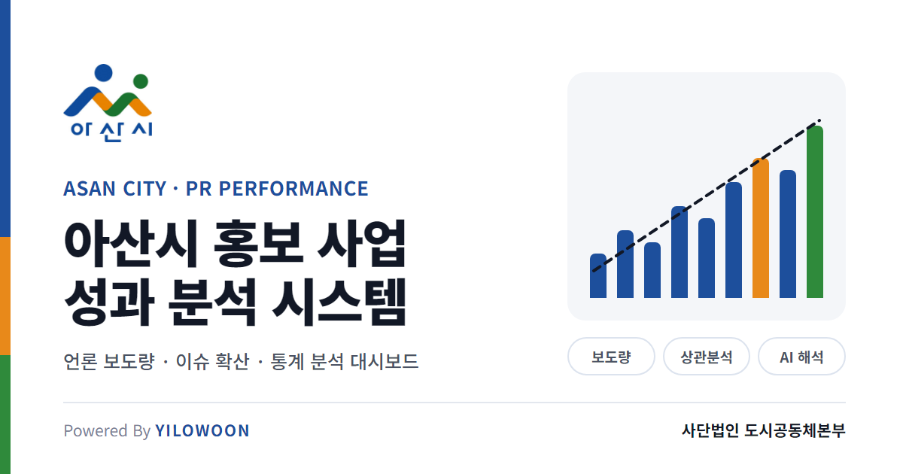
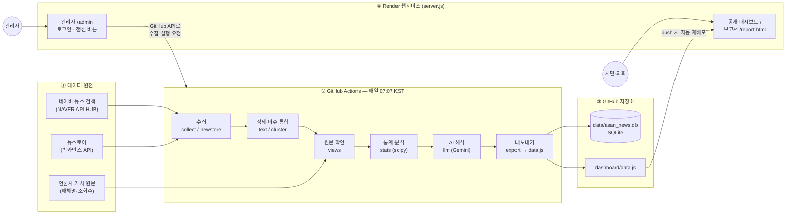
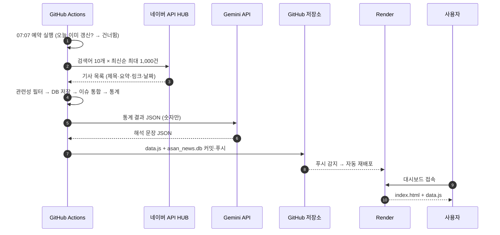

<p align="center">
  
</p>

<h1 align="center">아산시 홍보 사업 성과 분석 시스템</h1>

<p align="center">
  언론 보도를 매일 자동 수집하고, 통계로 분석하고, AI가 해석하는 공공 홍보 성과 대시보드<br>
  <sub>Powered By <b>YILOWOON</b> · 사단법인 도시공동체본부</sub>
</p>

---

## 📚 이 문서를 읽는 방법 (수강생 가이드)

이 저장소는 **"지자체 홍보 성과를 데이터로 증명하는 시스템"**을 처음부터 끝까지 만든 실습 결과물입니다.
아래 순서대로 읽고 따라 하면 같은 시스템을 여러분의 지역·주제로 만들 수 있습니다.

| 단계 | 내용 | 예상 소요 |
|---|---|---|
| [0. 권장 환경](#0-권장-환경-유료-ai-도구-사용-권고) | **Claude·Gemini 유료 버전 권고** | 5분 |
| [1. 무엇을 만들었나](#1-무엇을-만들었나) | 시스템 목적과 완성 화면 | 5분 |
| [2. 설계도](#2-설계도-아키텍처) | 전체 구조와 데이터 흐름 | 10분 |
| [3. 폴더 구조](#3-폴더-구조) | 파일별 역할 | 5분 |
| [4. 준비물: API 키 발급](#4-준비물-api-키-발급) | 네이버·뉴스토어·Gemini·GitHub | 30분 |
| [5. 내 PC에서 실행](#5-내-pc에서-실행하기) | 설치 → 수집 → 화면 확인 | 20분 |
| [6. 구현된 기능 상세](#6-구현된-기능-상세) | 수집·통합·통계·AI·관리자 | 30분 |
| [7. API 연동 방법](#7-api-연동-방법) | 각 API 호출 코드 해설 | 30분 |
| [8. 자동화와 배포](#8-자동화와-배포-github-actions--render) | GitHub Actions + Render | 30분 |
| [9. 내 지역으로 바꾸기](#9-내-지역주제로-바꾸기) | 검색어·분류 수정 | 10분 |
| [10. 문제 해결](#10-문제-해결-faq) | 실제로 겪은 오류와 해결법 | 필요할 때 |

> ⭐ **유료 AI 도구 사용을 권장합니다.** 이 시스템은 AI 코딩 도구(Claude Code)와 함께 만들었고, 분석에는 Gemini API를 씁니다.
> 무료 버전은 사용량 제한과 데이터 처리 조건 때문에 실습이 중간에 막히거나 공공 업무에 쓰기 어려울 수 있습니다. → [0. 권장 환경](#0-권장-환경-유료-ai-도구-사용-권고)

> 💡 **처음이라면** 4번(API 키)을 건너뛰고 `python run.py sample`로 샘플 화면부터 띄워 보세요. 키 없이도 전체 화면을 볼 수 있습니다.

---

## 0. 권장 환경: 유료 AI 도구 사용 권고

이 프로젝트를 따라 하거나 응용하려면 **Claude 또는 Gemini의 유료 버전 사용을 강력히 권고합니다.**

### 왜 유료 버전인가

| 구분 | 무료 버전에서 겪는 문제 | 유료 버전의 이점 |
|---|---|---|
| **사용량** | 대화·요청 한도가 낮아 코드 작성·수정·배포 과정이 중간에 끊김 | 긴 작업(설계 → 구현 → 디버깅 → 배포)을 한 흐름으로 진행 |
| **AI 코딩 도구** | Claude Code 등 코딩 에이전트는 유료 요금제 또는 API 결제가 필요 | 파일 생성·수정, 명령 실행, 오류 분석까지 AI가 직접 수행 |
| **성능** | 상위 모델 사용이 제한되거나 응답 길이가 짧음 | 복잡한 설계·통계 해석·보고서 작성에 상위 모델 사용 |
| **API 한도** | Gemini API 무료 등급은 분당·일일 호출 한도가 낮음 | 매일 자동 분석이 한도에 걸려 실패하지 않음 |
| **데이터 처리** | 무료 등급은 입력 내용이 서비스 개선에 활용될 수 있음 (각 서비스 약관 확인) | 업무 자료를 다룰 때 데이터 처리 조건이 상대적으로 명확 |

### 권장 구성

| 용도 | 권장 | 비고 |
|---|---|---|
| 시스템 개발·수정 (AI 코딩) | **Claude 유료 요금제(Pro 이상) + Claude Code** | 이 저장소는 Claude Code로 구축함 |
| 대안 | Gemini 유료 요금제(Google AI Pro 등) + Gemini 코딩 도구 | 개인 선호에 따라 선택 |
| 보고서 해석 (이 시스템의 AI 기능) | **Gemini API 유료 등급**(결제 수단 등록) | `GEMINI_API_KEY`에 사용. 매일 1회 호출이라 비용 부담 작음 |

> ⚠️ **공공기관 업무 자료**(내부 보고서, 미공개 예산, 개인정보 등)를 AI에 입력할 때는 반드시 **기관의 보안 지침**과 **각 서비스의 데이터 이용 약관**을 먼저 확인하세요.
> 이 시스템이 Gemini에 보내는 것은 **공개된 뉴스로 계산한 통계 수치뿐**이며, 기사 원문이나 개인정보는 보내지 않습니다.

> 💰 요금제 이름과 가격, 무료 한도는 자주 바뀝니다. 실습 전에 [Claude 요금제](https://claude.com/pricing)와 [Gemini API 요금](https://ai.google.dev/pricing) 페이지에서 최신 내용을 확인하세요.

---

## 1. 무엇을 만들었나

### 해결하려는 문제
아산시는 홍보비를 들여 보도자료를 배포하고 있지만, **"그래서 효과가 있었나?"**라는 시의회의 질문에 숫자로 답하기 어려웠습니다.

### 이 시스템이 하는 일
1. **수집** — 매일 아침 아산시 관련 뉴스를 자동으로 모읍니다.
2. **정리** — 무관한 기사(서울아산병원 등)를 거르고, 같은 보도자료로 쓴 비슷한 기사들을 하나의 "이슈"로 묶습니다.
3. **분석** — 보도량·확산도·매체 수를 일/주/월 단위로 집계하고, 상관분석·유의성 검정을 합니다.
4. **해석** — 계산된 통계를 Gemini(AI)가 공무원 보고서체로 해석합니다.
5. **공개** — 누구나 볼 수 있는 웹 대시보드와 보고서 페이지로 보여줍니다.

### 화면 구성

| 페이지 | 주소 | 누가 | 내용 |
|---|---|---|---|
| 공개 대시보드 | `/` | 누구나 | 핵심 지표 6개, 보도 추이, 주제·매체 분포, 성과표, 주요 이슈, 기사 목록 |
| 성과 보고서 | `/report.html` | 누구나 | 추세·상관·요일·주제 통계 분석 + AI 해석 |
| 관리자 | `/admin` | 로그인한 관리자 | 위 화면 + **"최신 데이터로 갱신"** 버튼 |

---

## 2. 설계도 (아키텍처)

### 2-1. 전체 구조



**핵심 아이디어:** 무거운 일(수집·분석)은 **GitHub Actions**가 하루 한 번 하고, 결과를 `data.js` 파일 하나로 만들어 저장소에 올립니다. **Render**는 그 파일을 화면에 보여주기만 합니다. 그래서 서버 비용이 거의 들지 않습니다.

### 2-2. 하루 동안 일어나는 일



### 2-3. 설계 원칙 (왜 이렇게 만들었나)

| 원칙 | 구현 | 이유 |
|---|---|---|
| **숫자는 코드가, 해석은 AI가** | 통계는 `scipy`로 계산 → Gemini에는 결과만 전달 | LLM은 계산을 틀릴 수 있음. 공공 보고서는 숫자가 정확해야 함 |
| **서버는 최소한으로** | 분석 결과를 정적 파일(`data.js`)로 만들어 배포 | 무료 플랜으로 운영 가능, 장애 지점 최소화 |
| **비밀값은 코드 밖에** | `.env`(로컬), GitHub Secrets, Render Environment | 저장소가 공개되어도 키가 노출되지 않음 |
| **한계는 숨기지 않기** | 화면·보고서에 "데이터 한계"와 "조회수 공개율" 항상 표시 | 의회 보고 자료의 신뢰성 |
| **실패해도 화면은 유지** | AI 호출 실패 시 직전 해석 재사용, 수집 실패 시 직전 데이터 유지 | 매일 자동 운영의 안정성 |

---

## 3. 폴더 구조

```text
AsanCity_NewsData/
├── run.py                    ← 모든 작업의 시작점 (명령어 모음)
├── asan_pr/                  ← 핵심 로직 (Python 패키지)
│   ├── config.py             ← ★ 검색어·주제 분류·통합 기준 (가장 먼저 수정할 파일)
│   ├── db.py                 ← SQLite 테이블 정의
│   ├── collect.py            ← 네이버 API HUB 뉴스 검색
│   ├── newstore.py           ← 뉴스토어(빅카인즈) API 기간 검색
│   ├── bigkinds.py           ← 빅카인즈 엑셀 가져오기 (API 대안)
│   ├── text.py               ← 제목 정규화·관련성 판단·주제 분류
│   ├── cluster.py            ← 유사 제목 → 이슈 통합
│   ├── views.py              ← 원문 페이지에서 매체명·조회수 읽기
│   ├── stats.py              ← 통계 분석 (추세·상관·검정)
│   ├── llm.py                ← Gemini 해석
│   ├── report.py             ← 통계 + AI 결과 묶기
│   ├── export.py             ← DB → dashboard/data.js
│   └── sample.py             ← 키 없이 화면 미리보기용 샘플 데이터
├── dashboard/                ← 웹 화면 (Render가 제공)
│   ├── index.html            ← 대시보드 + 관리자 화면
│   ├── report.html           ← 성과 통계 보고서
│   ├── data.js               ← 자동 생성되는 데이터 (직접 수정 X)
│   └── assets/               ← 로고, 공유 이미지(og-image.png)
├── data/asan_news.db         ← 수집 DB (자동 갱신)
├── server.js                 ← Render 웹서버 (정적 제공 + 로그인 + 갱신 API)
├── package.json              ← Render가 `npm start`로 server.js 실행
├── requirements.txt          ← Python 라이브러리 목록
├── render.yaml               ← Render 배포 설정(Blueprint)
├── .github/workflows/daily.yml ← 매일 자동 수집 스케줄
└── .env                      ← 내 PC용 비밀값 (Git에 올리지 않음)
```

---

## 4. 준비물: API 키 발급

| 키 | 용도 | 필수 | 발급처 | 비용 |
|---|---|---|---|---|
| `NAVER_CLIENT_ID` / `NAVER_CLIENT_SECRET` | 뉴스 수집 | ✅ | 네이버 클라우드 **NAVER API HUB** | 무료 한도 내 |
| `GEMINI_API_KEY` | 통계 해석 | 권장 | Google AI Studio | **유료 등급 권장** ([0장](#0-권장-환경-유료-ai-도구-사용-권고)) |
| `NEWSTORE_API_KEY` | 과거 기사 전수 수집 | 선택 | 한국언론진흥재단 뉴스토어 | 유료(견적) |
| `GITHUB_TOKEN` | 관리자 갱신 버튼 | 선택 | GitHub 개인 설정 | 무료 |

### 4-1. 네이버 뉴스 검색 키 (2026년 발급처 변경)

> 2026년 7월 31일부터 **네이버 개발자센터(developers.naver.com)에서는 검색 API 신규 발급이 중단**되었습니다.
> 개발자센터의 "사용 API" 목록에 "검색"이 보이지 않는 것이 정상입니다.

1. [네이버 클라우드 콘솔](https://console.ncloud.com) 로그인 (처음이면 회원가입)
2. **Services → Application Service → NAVER API HUB → Application**
3. **Application 등록** → 이름 입력(예: `Newsdata`) → **검색(뉴스)** 상품 선택
4. 목록에서 앱 선택 → **인증 정보**에서 Client ID / Client Secret 복사

| 구분 | (구) 개발자센터 | (신) API HUB |
|---|---|---|
| 주소 | `openapi.naver.com/v1/search/news.json` | `naverapihub.apigw.ntruss.com/search/v1/news` |
| 인증 헤더 | `X-Naver-Client-Id` / `-Secret` | `X-NCP-APIGW-API-KEY-ID` / `X-NCP-APIGW-API-KEY` |

### 4-2. Gemini 키
1. [Google AI Studio](https://aistudio.google.com/apikey) → **Create API key**
   - 매일 자동 분석이 한도에 걸리지 않도록 **결제 수단을 등록해 유료 등급으로 사용**하는 것을 권장합니다
2. 사용할 모델 이름도 함께 정합니다 (이 프로젝트: `gemini-3.1-flash-lite`)

### 4-3. 뉴스토어(빅카인즈) 키 — 선택
- [뉴스토어](https://www.newstore.or.kr)에서 **빅카인즈 API(뉴스검색)** 상품 구매 후 발급
- 키가 없어도 시스템은 동작합니다. 다만 네이버 검색은 **검색어당 최신 1,000건까지만** 주므로, 몇 달 전 기사는 덜 모입니다.
- API 대신 [빅카인즈](https://www.bigkinds.or.kr)에서 검색 결과를 엑셀로 내려받아 넣는 방법도 있습니다 (`run.py bigkinds`).

### 4-4. 키 보관 규칙 🔐
```text
내 PC            → .env 파일          (Git에 올라가지 않도록 .gitignore에 등록됨)
GitHub Actions   → Settings → Secrets and variables → Actions → "Secrets" 탭
Render 서버      → 서비스 → Environment
```
> ❌ 키를 코드, README, 스크린샷, 채팅에 그대로 붙여넣지 마세요. 노출되었다면 즉시 **재발급**하세요.

---

## 5. 내 PC에서 실행하기

### 5-1. 설치
```bash
git clone https://github.com/yilowoon/AsanCity_NewsData.git
cd AsanCity_NewsData
pip install -r requirements.txt
```
필요 환경: Python 3.10 이상, Node.js 18 이상(관리자 기능 확인 시)

### 5-2. 키 없이 샘플로 먼저 보기
```bash
python run.py sample
python -m http.server 8765 --directory dashboard
```
브라우저에서 `http://localhost:8765` 접속 → 상단에 **"샘플 데이터"** 표시와 함께 전체 화면이 보이면 성공입니다.

### 5-3. 실제 데이터로 실행
프로젝트 폴더에 `.env` 파일을 만듭니다.
```ini
NAVER_CLIENT_ID=발급받은_ID
NAVER_CLIENT_SECRET=발급받은_Secret
GEMINI_API_KEY=발급받은_키
GEMINI_TEXT_MODEL=gemini-3.1-flash-lite
# NEWSTORE_API_KEY=구매_후_입력
# 관리자 화면을 로컬에서 시험할 때만
ADMIN_ID=admin
ADMIN_PASSWORD=원하는_비밀번호
```
```bash
python run.py daily     # 수집 → 원문 확인 → 이슈 통합 → 통계 → AI 해석 → data.js
```

### 5-4. 명령어 모음

| 명령 | 하는 일 |
|---|---|
| `python run.py daily` | 하루치 전체 작업 (자동화가 매일 실행하는 명령) |
| `python run.py collect` | 네이버 뉴스 수집만 |
| `python run.py newstore --from 2026-01-01` | 뉴스토어 API로 기간 전체 수집 (`--body`: 본문 포함 상품) |
| `python run.py bigkinds 파일.xlsx` | 빅카인즈 엑셀 가져오기 |
| `python run.py views --limit 100` | 원문 페이지에서 매체명·조회수 확인 |
| `python run.py cluster` | 유사 기사 이슈 통합 다시 하기 |
| `python run.py report` | 통계 + Gemini 해석 새로 만들기 |
| `python run.py build` | data.js만 다시 만들기 (AI 해석은 직전 것 재사용) |
| `python run.py sample` | 샘플 데이터로 화면 미리보기 |

### 5-5. 관리자 화면까지 로컬에서 보기
```bash
# Windows PowerShell 예시
$env:ADMIN_ID="admin"; $env:ADMIN_PASSWORD="원하는_비밀번호"; npm start
```
`http://localhost:10000/admin` 접속 → 로그인

---

## 6. 구현된 기능 상세

### 6-1. 수집과 관련성 필터 (`collect.py`, `text.py`)
- `config.py`의 **검색어 10개**(아산시, 아산시의회, 아산 온양온천, 아산 이순신축제 …)를 최신순으로 검색합니다.
- "아산"이 들어가도 **아산시와 무관한 기사**(서울아산병원, 현대아산, 아산나눔재단 등)는 `UNRELATED_TERMS`로 걸러냅니다.
- 같은 기사가 여러 검색어에 걸려도 **URL 기준으로 한 번만** 저장됩니다.
- 제목·요약의 키워드로 **9개 주제**(행정·경제·관광·복지·교육·도시·환경·의회·체육)를 자동 분류합니다.

### 6-2. 유사 기사 → 이슈 통합 (`cluster.py`)
보도자료 1건이 30개 매체에 실리면 기사는 30건이지만 **이슈는 1개**입니다. 이 구분이 "확산력" 분석의 핵심입니다.

```text
① 제목 정규화   "[포토] (아산=뉴스) 아산시, 축제 개막"  →  "아산시 축제 개막"
② 문자 2-gram   {"아산","산시","시축","축제","제개","개막"}
③ 자카드 유사도 = 겹치는 2-gram 수 ÷ 전체 2-gram 수  ≥ 0.45 이면 같은 이슈
④ 비교 범위     3일 이내 기사끼리만, 한 이슈는 최대 7일까지
⑤ 대표 제목     다른 제목들과 가장 비슷한 제목(medoid), 말머리 제거
```
비교 대상을 줄이기 위해 **(날짜, 단어) 역색인**을 사용합니다. 수만 건도 몇 초 안에 처리됩니다.

### 6-3. 원문 확인: 매체명과 조회수 (`views.py`)
- 기사 원문 페이지의 `og:site_name`으로 **도메인 대신 실제 매체명**을 표시합니다.
- `robots.txt`에서 금지한 사이트는 방문하지 않습니다.
- **조회수의 현실:** 언론사 조회수는 내부 자료라 대부분 공개되지 않습니다. 실제 확인 결과 6,211건 중 **24건(0.4%)**만 확보되었습니다. 오인식을 막기 위해 검증된 매체(`VIEWS_TRUSTED_DOMAINS`)만 인정하며, 화면에 **조회수 공개율**을 함께 표시합니다.

### 6-4. 대시보드 (`dashboard/index.html`)
- **기간 설정**: 최근 7일/30일/이번 달/3개월/전체 + 직접 지정, **집계 단위** 일간/주간/월간, **주제 필터**
- **핵심 지표 6개**: 보도 건수·통합 이슈·보도 매체·확인 조회수·이슈당 평균 보도·대형 확산 이슈 (직전 동기간 대비 증감)
- **성과 지표 체계**: 노출 · 확산 · 도달 · 지속 · 매체 다양성 · 이슈 집중도
- **주요 이슈 표**: 행을 누르면 그 이슈에 속한 기사 목록이 펼쳐짐, CSV 내려받기
- 다크 모드, 인쇄, 모바일 화면 지원 / 차트는 Chart.js

### 6-5. 통계 분석 (`stats.py`) — 숫자는 여기서만 만듭니다

| 분석 | 방법 | 묻는 질문 |
|---|---|---|
| 기술통계 | 평균·표준편차·중앙값·변동계수 | 보도량이 얼마나 들쭉날쭉한가 |
| 추세 | 선형회귀(기울기·R²·p) + Spearman ρ | 보도량이 늘고 있는가 |
| 상관 | Pearson r(95% 신뢰구간: Fisher z) + Spearman ρ, **Holm 다중비교 보정** | 보도량은 이슈 수 때문인가, 확산 때문인가 |
| 요일 효과 | Mann-Whitney U (효과크기 r), Kruskal-Wallis | 평일과 주말 차이가 있는가 |
| 주제별 확산력 | Kruskal-Wallis H (효과크기 ε²) | 어떤 분야 보도자료가 더 널리 퍼지는가 |
| 주제 구성 변화 | 카이제곱 독립성 검정 (Cramér's V) | 시기별로 홍보 주제가 달라지는가 |
| 홍보비 연계 | 월별 Pearson·Spearman, 보도 1건당 홍보비 | 예산과 보도량이 함께 움직이는가 (`data/budget.csv` 제공 시) |

> 📌 **실제 분석에서 얻은 핵심 발견:** 주간 보도량은 *이슈 수*와 매우 강하게 상관(r≈0.99)되지만 *이슈당 확산도*와는 상관이 없었습니다(r≈0.12, 유의하지 않음). 즉 **보도량 증가는 기사가 널리 퍼져서가 아니라 보도자료 가짓수가 늘어서**였습니다.

홍보비 분석을 켜려면 `data/budget.csv`를 추가합니다.
```csv
month,amount
2026-01,15000000
2026-02,12000000
```

### 6-6. AI 해석 (`llm.py`, `report.py`)
- Gemini에는 **계산이 끝난 통계 JSON만** 보냅니다. 차트용 원자료는 빼서 토큰을 줄입니다.
- 프롬프트 핵심 규칙:
  1. JSON에 있는 수치만 사용, 새 수치 생성 금지
  2. Holm 보정 p값 기준으로 유의성 판단, 상관을 인과로 단정 금지
  3. 데이터 한계(수집 편향·작은 표본)를 문장 안에 반영
  4. 공무원 보고서체(개조식, "~함", "~임")
- `responseMimeType: application/json`으로 **정해진 형식의 JSON**만 받습니다.
- 키가 없거나 호출이 실패하면 **직전 해석을 그대로 유지**합니다.

### 6-7. 관리자 모드 (`server.js`)
- `/admin` 접속 → 로그인 → **"최신 데이터로 갱신"** 버튼 표시 (공개 페이지에는 버튼 없음)
- 계정은 코드가 아니라 **환경변수**(`ADMIN_ID`, `ADMIN_PASSWORD`)로 설정
- 보안: HMAC 서명 쿠키(HttpOnly, SameSite=Strict, 8시간), **5회 실패 시 15분 잠금**, 갱신은 10분에 1회
- 버튼을 누르면 → 서버가 GitHub API로 수집 작업 실행 → 진행 상황 표시 → 재배포되면 화면 자동 새로고침

### 6-8. 공유 미리보기 (OG 태그)
- `dashboard/assets/og-image.png` (1200×630) + `og:title`, `og:description`, `twitter:card`
- 카카오톡·페이스북은 이미지 주소가 **절대 URL**이어야 하므로, HTML의 `%%ORIGIN%%`을 `server.js`가 접속 도메인으로 바꿔 줍니다.

---

## 7. API 연동 방법

### 7-1. 네이버 API HUB — 뉴스 검색 (`collect.py`)
```python
params = {"query": "아산시", "display": 100, "start": 1, "sort": "date"}
req = urllib.request.Request(
    "https://naverapihub.apigw.ntruss.com/search/v1/news?" + urlencode(params),
    headers={"X-NCP-APIGW-API-KEY-ID": CLIENT_ID, "X-NCP-APIGW-API-KEY": CLIENT_SECRET},
)
```
- 한 번에 100건, `start`를 1 → 101 → … → 901로 넘기며 **최대 1,000건**
- 시작일(2026-01-01)보다 오래된 기사가 나오면 그 검색어는 멈춤
- 응답 제목의 `<b>` 태그와 `&quot;` 같은 HTML 엔티티는 `text.clean()`으로 제거

### 7-2. 뉴스토어(빅카인즈) — 기간 검색 (`newstore.py`)
```python
body = {
  "access_key": NEWSTORE_API_KEY,
  "argument": {
    "query": "아산시",
    "published_at": {"from": "2026-01-01", "until": "2026-01-31"},
    "sort": {"date": "asc"},
    "return_from": 0, "return_size": 1000,
    "fields": ["news_id", "title", "published_at", "provider", "provider_link_page", "hilight"],
  },
}
# POST https://www.newstore.or.kr/api-newstore/v1/search/newsList.json  (Content-Type: application/json)
```
- 네이버와 달리 **기간을 지정**할 수 있어 과거 기사를 빠짐없이 모읍니다.
- 한 요청의 한도(`return_from` ≤ 20,000)를 넘지 않도록 **한 달 단위로 나눠** 요청합니다.
- 응답의 `returnObject`는 **JSON이 문자열로 한 번 더 감싸져** 있어 두 번 파싱합니다.
- 본문까지 필요하면 `newsAllList.json`(본문포함 상품) + `--body` 옵션을 사용합니다.

### 7-3. Gemini — 통계 해석 (`llm.py`)
```python
body = {
  "contents": [{"role": "user", "parts": [{"text": PROMPT + 통계_JSON}]}],
  "generationConfig": {"temperature": 0.2, "responseMimeType": "application/json"},
}
POST {GEMINI_BASE_URL}/v1beta/models/{GEMINI_TEXT_MODEL}:generateContent
Header: x-goog-api-key: {GEMINI_API_KEY}
```
- `temperature 0.2`: 매번 비슷하고 안정적인 문장
- 응답 `candidates[0].content.parts[0].text`를 JSON으로 읽어 `headline`, `key_findings`, `sections`, `recommendations`를 화면에 표시

### 7-4. GitHub API — 관리자 갱신 버튼 (`server.js`)
```javascript
// 수집 작업 실행
POST https://api.github.com/repos/{owner}/{repo}/actions/workflows/daily.yml/dispatches
     { "ref": "main" }
// 진행 상태 확인
GET  https://api.github.com/repos/{owner}/{repo}/actions/workflows/daily.yml/runs?per_page=1
Header: Authorization: Bearer {GITHUB_TOKEN}
```
`GITHUB_TOKEN`은 Render 서버가 GitHub에 "수집을 실행해 달라"고 요청할 때 쓰는 **출입증**입니다.
권한은 **이 저장소 하나, Actions 읽기/쓰기만** 주세요.

---

## 8. 자동화와 배포 (GitHub Actions + Render)

### 8-1. GitHub Secrets 등록
저장소 **Settings → Secrets and variables → Actions → Secrets 탭 → New repository secret**

| Name | 필수 |
|---|---|
| `NAVER_CLIENT_ID` | ✅ |
| `NAVER_CLIENT_SECRET` | ✅ |
| `GEMINI_API_KEY` | 권장 |
| `NEWSTORE_API_KEY` | 선택 (비어 있으면 뉴스토어 수집만 건너뜀) |

### 8-2. 매일 자동 수집 (`.github/workflows/daily.yml`)
```yaml
on:
  schedule:
    - cron: "7 22 * * *"    # 07:07 KST  ← UTC 기준으로 적어야 함 (KST = UTC+9)
    - cron: "37 22 * * *"   # 07:37 KST  (지연·누락 대비)
    - cron: "7 23 * * *"    # 08:07 KST  (지연·누락 대비)
  workflow_dispatch:        # 수동 실행 / 관리자 버튼
```
- GitHub 예약 실행은 **정각(:00)에 몰려 수 시간 지연되거나 빠질 수 있습니다.** 그래서 정각을 피해 세 번 예약하고, 그날 07시 이후 이미 갱신했으면 나머지는 건너뜁니다.
- 마지막 단계에서 `data.js`와 `asan_news.db`를 커밋합니다. 실행 중 다른 커밋이 올라와도 실패하지 않도록 `git pull --rebase` 후 푸시합니다.
- 수동 실행: 저장소 **Actions → daily-collect → Run workflow**

### 8-3. Render 배포
1. [Render](https://render.com) → **New → Web Service** → 이 저장소 연결 (또는 **New → Blueprint**로 `render.yaml` 사용)
2. 설정

   | 항목 | 값 |
   |---|---|
   | Language | Node |
   | Build Command | `npm install` |
   | Start Command | **`npm start`** |

3. **Environment**에 환경변수 추가

   | Key | 설명 |
   |---|---|
   | `ADMIN_ID` / `ADMIN_PASSWORD` | 관리자 로그인 계정 |
   | `GITHUB_TOKEN` | 갱신 버튼용 GitHub 토큰 (Fine-grained, Actions: Read and write) |
   | `PUBLIC_URL` | (선택) 공유 미리보기에 쓸 고정 주소 |

4. 저장소에 푸시될 때마다 **자동 재배포**됩니다.

> 💡 무료 웹서비스는 15분간 접속이 없으면 잠들어 첫 접속이 30초~1분 걸립니다. 관리자 기능이 필요 없다면 **Static Site**(Publish directory `dashboard`)로 배포해도 됩니다.

### 8-4. GitHub 토큰 발급 (관리자 버튼용)
[github.com/settings/personal-access-tokens/new](https://github.com/settings/personal-access-tokens/new)
- Repository access: **Only select repositories** → 이 저장소
- Permissions → Repository → **Actions: Read and write**
- 생성된 `github_pat_…` 값은 **한 번만 보이니** 바로 Render에 등록

> ℹ️ 워크플로가 결과를 커밋할 때 쓰는 토큰은 GitHub이 자동으로 주는 **내장 토큰**입니다 (`permissions: contents: write`). 따로 만들 필요가 없습니다.

---

## 9. 내 지역·주제로 바꾸기

대부분 `asan_pr/config.py` **한 파일**만 고치면 됩니다.

```python
START_DATE = date(2026, 1, 1)                # 분석 시작일
SEARCH_QUERIES = ["천안시", "천안시의회", ...]  # 검색어
UNRELATED_TERMS = ["…동명이인 기관명…"]        # 무관한 기사 제외 단어
LOCAL_TERMS = ["천안시", "동남구", "서북구", ...]  # 지역 판단 단어
TOPICS = {"관광·문화·축제": ["축제", "관광", ...], ...}  # 주제 분류 키워드
CLUSTER_SIMILARITY = 0.45                    # 높이면 이슈를 더 엄격하게 묶음
```
그다음 화면 문구(`dashboard/index.html`, `report.html`의 제목)와 로고(`dashboard/assets/`)를 바꾸면 끝입니다.

**실습 과제 예시**
1. 검색어를 우리 지역으로 바꾸고 `python run.py daily` 실행
2. `UNRELATED_TERMS`가 필요한 동명이인 사례 찾기 (예: "중구"는 여러 도시에 있음)
3. `CLUSTER_SIMILARITY`를 0.35 / 0.55로 바꿔 이슈 수가 어떻게 달라지는지 비교
4. `data/budget.csv`를 만들어 홍보비 연계 분석 켜기

---

## 10. 문제 해결 (FAQ)

실제 구축 과정에서 겪은 문제들입니다.

| 증상 | 원인 | 해결 |
|---|---|---|
| 네이버 개발자센터에 "검색" API가 없음 | 2026.7.31 신규 발급 중단 | [4-1](#4-1-네이버-뉴스-검색-키-2026년-발급처-변경)대로 NAVER API HUB에서 발급 |
| Render 배포 실패 `start: command not found` (status 127) | Start Command가 `start`로 설정됨 | Start Command를 `npm start`로 변경 |
| Actions 실패 ".env 파일에 NAVER_CLIENT_ID… 입력하세요" | Secrets 미등록 | [8-1](#8-1-github-secrets-등록) 등록 후 Re-run |
| 오전 8시에 갱신되지 않음 | GitHub 예약 실행 지연·누락 | 정각을 피한 다중 예약(현재 설정), 급하면 관리자 버튼 |
| Actions 마지막 단계 `push rejected (fetch first)` | 실행 중 다른 커밋이 올라옴 | 현재 워크플로는 `pull --rebase` 후 재시도 |
| `refusing to allow an OAuth App to … workflow` | 내 Git 인증에 `workflow` 권한 없음 | `.github/workflows/` 파일은 GitHub 웹에서 직접 수정 |
| 관리자 버튼이 비활성 "GITHUB_TOKEN이 설정되지 않았습니다" | Render에 토큰 없음 | [8-4](#8-4-github-토큰-발급-관리자-버튼용) |
| "관리자 계정이 설정되지 않았습니다" | Render에 `ADMIN_ID`/`ADMIN_PASSWORD` 없음 | Render Environment에 추가 |
| 차트가 카드 밖으로 삐져나옴 | CSS Grid 기본 `min-width: auto` | `grid-template-columns: minmax(0, 1fr)` |
| 공개 페이지에 관리자 버튼이 보임 | `display:flex`가 `hidden` 속성을 덮어씀 | `[hidden] { display: none !important; }` |
| 조회수가 거의 0 | 언론사 대부분 조회수 비공개 | 정상. 공개율과 함께 해석, 필요 시 매체에 공식 요청 |
| 1~2월 기사가 너무 적음 | 네이버 검색은 최신 1,000건 한도 | 뉴스토어 API 또는 빅카인즈 엑셀로 과거분 보강 |

---

## 📊 데이터 한계 (보고서 작성 시 반드시 함께 제시)

- 네이버 검색 기준 자료는 과거 기간이 **과소 집계**될 수 있습니다 → 추세 해석 시 수집 편향 명시
- 주간 시계열은 자기상관이 있어 상관분석 p값은 **참고용**입니다
- **상관관계는 인과관계가 아닙니다**
- 조회수는 공개 매체만 집계되며 실제 노출 규모는 이보다 큽니다
- AI 해석은 계산된 수치를 근거로 작성되지만, **최종 판단은 담당자 검토**를 거쳐야 합니다

---

<p align="center">
  <sub>Powered By <b>YILOWOON</b> · © 2026 사단법인 도시공동체본부</sub>
</p>
